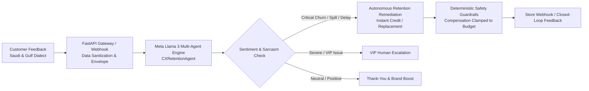

# Meta Global AI Developer Hackathon Submission

**Project Title:** Meqyas AI — Autonomous Customer Retention & Sentiment Intelligence Engine  
**Track:** Startup Track  
**Theme:** Build for Your World  
**Live Production URL:** [https://meqyas.wardat.xyz/](https://meqyas.wardat.xyz/)  
**GitHub Repository:** [https://github.com/moon15mm/meqyas-ai](https://github.com/moon15mm/meqyas-ai)  
**Demo Video URL (YouTube):** [https://youtu.be/K0VfvQ25ibI](https://youtu.be/K0VfvQ25ibI)  
**Founder:** Eng. Maher Sulaiman (Wardat AI Technologies) — `contact@wardat.xyz`

---

## 1. Elevator Pitch
Meqyas AI is an autonomous, dialect-aware customer retention and sentiment intelligence engine for GCC e-commerce. Powered by Meta Llama 3 open weights, it decodes nuanced Gulf and Saudi Arabic dialects, detects micro-frustrations before churn happens, and automatically synthesizes personalized, budget-safe retention remedies in real time.

---

## 2. The Problem: The GCC E-Commerce Retention Dilemma
In the fast-growing GCC e-commerce and delivery ecosystem:
- **High CAC vs. Fragile Retention:** Customer Acquisition Cost is at an all-time high. A single spilled container, courier delay, or damaged item leads to immediate churn.
- **Dialect & Sarcasm Blindness:** Traditional NLP models fail on Saudi & Gulf Arabic colloquialisms (e.g., *"والله ما قصرتوا بس الطلب مدهوك والشوربة كبت"* or sarcastic praise like *"ما شاء الله أسرع مطعم.. ساعتين أنتظر والأكل مثلج"*).
- **Slow Response Times:** Conventional customer support tickets take hours or days. By that time, the frustrated customer has already vented publicly on social media and switched to a competitor.

---

## 3. The Solution: Meqyas Autonomous Multi-Agent Retention Pipeline
Meqyas AI transforms reactive complaints into proactive real-time resolution:
1. **Real-Time Webhook Ingestion:** Captures order events and customer feedback across store webhooks (Salla, Zid, Shopify) and CX pulse surveys.
2. **Dialect & Sarcasm Analysis (`CXRetentionAgent`):** Uses Meta Llama 3 to classify dialect (`saudi_najdi`, `saudi_hijazi`, `gulf_general`, etc.), isolate operational root causes (`packaging_spill`, `courier_delay`, `missing_item`), and detect sarcasm.
3. **Calibrated Churn Risk & Remediation:** Analyzes order context and Customer Lifetime Value (CLV) to formulate an authorized remedy: instant wallet credit, discount coupon, replacement, or VIP escalation.
4. **Deterministic Margin Safeguards:** Python post-processing enforces strict commercial guardrails—compensation is automatically clamped against order value and customer tier to prevent merchant margin leakage.

---

## 4. How Meta Llama & Open-Weights Are Architected in the Codebase

All AI logic is implemented in the open-source `packages/ai` layer:

1. **Native Meta Llama Provider (`packages/ai/meqyas_ai/providers/factory.py`):**
   - Configured with `AI_PROVIDER=meta_llama` or `AI_PROVIDER=ollama`.
   - **Smart Tier:** `meta-llama/Llama-3.3-70B-Instruct` (or `llama3.3:70b`) for nuanced Arabic dialect disambiguation, sarcasm detection, and empathetic Arabic response generation.
   - **Fast Tier:** `meta-llama/Llama-3.2-3B-Instruct` (or `llama3.2:3b`) for sub-second classification, token budgeting, and zero-PII local inference.
2. **Rigorous Agent Contract (`packages/ai/meqyas_ai/agents/cx_retention_agent.py`):**
   - Strictly typed input and output schemas via Pydantic (`RetentionAnalysisIn` / `RetentionAnalysisOut`).
   - Untrusted data envelopes (`<untrusted_data>`) to neutralize prompt injection attacks.
3. **Verified Test Suite (`packages/ai/tests/test_cx_retention_agent.py`):**
   - Full test coverage for Saudi Najdi and Hijazi dialect processing, sarcasm detection, and deterministic compensation clamping.
   - Entire AI test suite (83 unit tests) passes in under 5 seconds.

---

## 5. Technical Stack & Production Readiness
- **Backend:** Python 3.12, FastAPI, SQLAlchemy 2 (Async), Alembic, Pydantic v2.
- **AI Core (`packages/ai`):** Multi-agent orchestrator with typed agent contracts, prompt injection defense, and structured JSON output repair loops.
- **Frontend & Dashboard:** Next.js 16 (App Router), React 19, TypeScript, Tailwind CSS v4, RTL Arabized UX.
- **Data & Caching:** PostgreSQL 17, Redis 7 (rate limiting, queue processing, agent memory).
- **Data Residency Compliance:** Full support for on-premise inference via Ollama / vLLM, ensuring zero customer PII leaves Saudi Arabia (compliant with the Saudi Personal Data Protection Law - PDPL).

---

## 6. 3-Minute Demo Video Walkthrough

- **0:00 - 0:45 | The Problem:** The high cost of customer churn in GCC commerce and the failure of traditional tools to understand Arabic dialects and sarcasm.
- **0:45 - 01:45 | Live Agent Execution:**
  - Running a real Saudi dialect complaint through `CXRetentionAgent`.
  - Showing Meta Llama 3 extracting the dialect, detecting sarcastic distress, diagnosing the spill, and calculating churn risk.
  - Showing the autonomous remedy generated with authentic Arabic messaging.
- **01:45 - 02:25 | Code Architecture & Meta Llama Advantage:**
  - Walking through `packages/ai/meqyas_ai/agents/cx_retention_agent.py` and `providers/factory.py`.
  - Explaining why Meta's open weights allow sovereign enterprise deployment with zero PII leaks.
- **02:25 - 03:00 | Production Readiness:**
  - Running the 83-test verification suite live on camera.
  - Reviewing the live production platform at [meqyas.wardat.xyz](https://meqyas.wardat.xyz/).
