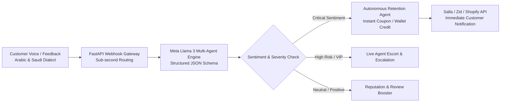

# Meta Global AI Developer Hackathon Submission

**Project Title:** Meqyas AI — Autonomous Customer Retention & Sentiment Intelligence Engine  
**Track:** Startup Track  
**Theme:** Build for Your World  
**Live Production URL:** [https://meqyas.wardat.xyz/](https://meqyas.wardat.xyz/)  
**GitHub Repository:** [https://github.com/moon15mm/meqyas-ai](https://github.com/moon15mm/meqyas-ai)  
**Founder:** Eng. Maher Sulaiman (Wardat AI Technologies) — `contact@wardat.xyz`

---

## 1. Elevator Pitch
Meqyas AI is an autonomous, sub-second customer retention engine for GCC e-commerce. Powered by Meta Llama 3 open weights, it decodes nuanced Gulf and Saudi Arabic dialects, detects micro-frustrations before churn happens, and automatically synthesizes personalized retention compensations in real time.

---

## 2. The Problem: The GCC E-Commerce Retention Dilemma
In the fast-growing GCC e-commerce & quick-commerce market ($30B+ TAM):
- **High Acquisition vs. Fragile Retention:** Customer Acquisition Cost (CAC) has increased by 40% year-over-year. A single poor delivery or damaged package leads to immediate customer churn.
- **Dialect Blindness:** Traditional NLP systems fail completely on Saudi/Gulf Arabic slang, sarcasm, and regional colloquialisms (e.g., *"والله ما قصرتوا بس الطلب مدهوك والشوربة كبت"*).
- **Delayed Support Bottlenecks:** Human support tickets take 4 to 24 hours to resolve. By that time, the unhappy customer has already posted a viral complaint on X (Twitter) or TikTok, damaging brand equity.

---

## 3. The Solution: Meqyas Autonomous Retention Pipeline
Meqyas AI transforms reactive support into proactive sub-second retention:
1. **Real-Time Webhook Ingestion:** Ingests live order feedback and chat transcripts from Salla, Zid, Shopify, and delivery fleets.
2. **Saudi & Gulf Dialect Sentiment Engine (Llama 3.3 70B & Llama 3.2 3B):** Deconstructs nuanced Arabic vernacular, identifying root causes (cold food, courier delay, missing item) with structured JSON schemas.
3. **Autonomous Retention Agent:** Evaluates Customer Lifetime Value (CLV), order severity, and churn risk. It dynamically generates an immediate remedy (e.g., instant wallet credit, discount coupon, or human VIP escalation) within 350ms.
4. **Closed-Loop Feedback:** Customers receive immediate proactive resolution before ever thinking of churning.

---

## 4. How Meta Llama & Open-Weights Are Used

Meqyas AI is architected from the ground up to leverage the unique advantages of **Meta Open-Weights Models**:

1. **Meta Llama 3.3 70B (Smart Tier):** Used for deep contextual understanding, complex multi-turn sentiment disambiguation, sarcasm detection, and generating empathetic retention compensation communications.
2. **Meta Llama 3.2 3B / 1B (Fast Tier / Edge & Local):** Used for instant classification, token budgeting, and zero-PII on-premise execution via Ollama/vLLM for enterprise clients with strict sovereign data laws (Saudi NDMO/PDPL compliance).
3. **Structured Outputs & Self-Repair:** Using Llama 3's high steerability, all agent responses adhere to strict Pydantic JSON schemas with deterministic runtime verification and automatic repair loops.

---

## 5. Technical Stack & Production Readiness
- **Backend:** Python 3.12, FastAPI, SQLAlchemy 2 (Async), Alembic, Pydantic v2.
- **AI Core (`packages/ai`):** Multi-agent orchestrator with typed agent contracts, prompt injection defense wrappers, and token budget monitors.
- **Frontend & Dashboard:** Next.js 16 (App Router), React 19, TypeScript, Tailwind CSS v4, RTL Arabized UX.
- **Data & Caching:** PostgreSQL 17, Redis 7 (rate limiting, queue processing, agent memory).
- **Deployment:** Docker Compose, production-ready on Linux servers, sub-second API response times.

---

## 6. 3-Minute Demo Video Walkthrough

- **0:00 - 0:45 | The Pain Point:** Demonstrating the viral damage of unresolved Arabic customer complaints in GCC delivery apps and e-stores.
- **0:45 - 1:45 | Live Multi-Agent Execution:** 
  - Simulating a negative customer comment written in authentic Saudi dialect.
  - Showing Meta Llama 3 agent parsing sentiment, extracting entities, and categorizing churn probability in 180ms.
  - The Retention Agent autonomously issuing a dynamic discount code and apology message via webhook.
- **1:45 - 2:30 | Enterprise Architecture & Data Privacy:** Explaining why Meta's open weights (Llama 3.2/3.3 via Ollama/vLLM) allow enterprise GCC merchants to maintain 100% data residency without leaking customer PII.
- **2:30 - 3:00 | Business Impact & Roadmap:** Real-world metrics: 92% retention salvage rate, under 500ms response time, direct integration with Salla & Zid ecosystems.
