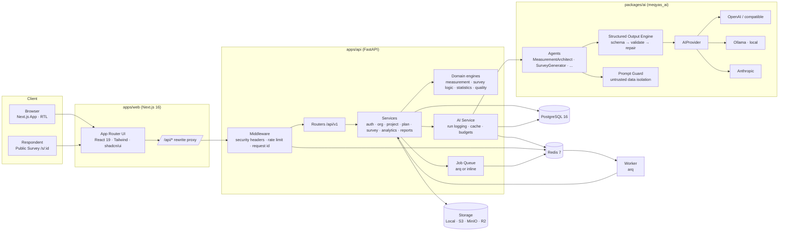
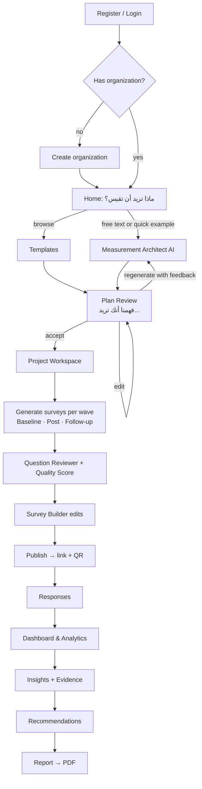
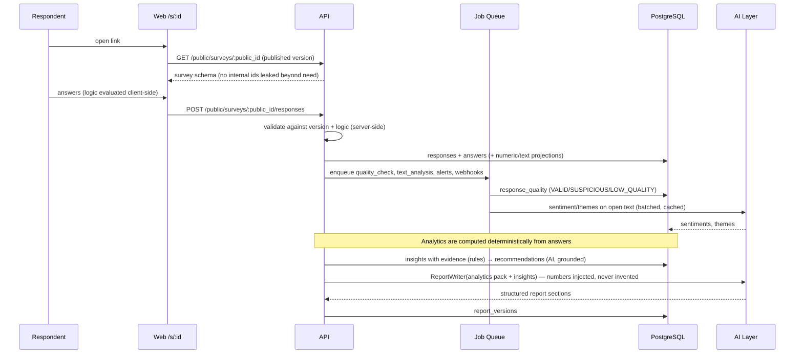
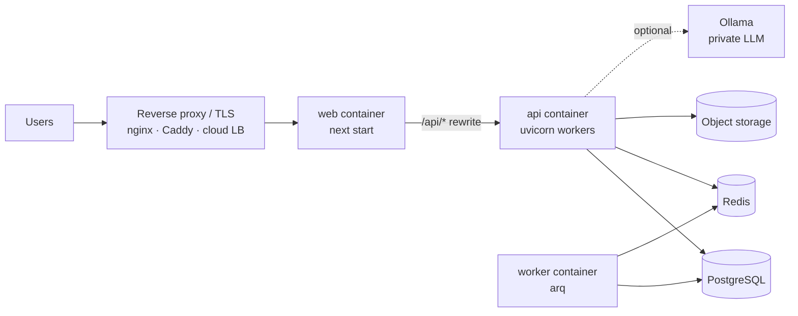

# Architecture

> **ملخص:** Monorepo يضم واجهة Next.js وواجهة برمجية FastAPI وطبقة AI مستقلة (Python package) وحزم TypeScript مشتركة. قاعدة البيانات PostgreSQL، وRedis للتخزين المؤقت والمهام الخلفية وتحديد المعدل. كل مكوّن خارجي (AI، التخزين، المهام) خلف واجهة Abstraction قابلة للاستبدال.

## 1. System Architecture



### Why this shape
| Decision | Reason |
|---|---|
| **Next.js rewrites `/api/*` → FastAPI** | Browser talks to a single origin → first-party HttpOnly cookies, no CORS in production, simpler CSP. |
| **AI as a separate Python package (`packages/ai`)** | Agents/providers have zero dependency on the web framework or DB → testable in isolation, reusable by workers, swappable providers. |
| **Domain engines are pure functions** | Statistics, survey logic, quality checks and measurement rules are deterministic and unit-tested without DB/AI. |
| **Logic engine implemented in TS *and* Python with shared test vectors** | The respondent's browser evaluates skip/display logic instantly; the server re-validates on submit. `tests/fixtures/logic-cases.json` guarantees parity. |
| **Async SQLAlchemy + asyncpg** | AI calls are long I/O; async keeps workers free. asyncpg works with the Windows Proactor loop. |
| **Redis optional in development** | Cache, rate limits and jobs fall back to in-process implementations so `pnpm dev` works with only PostgreSQL. In production Redis is required. |

## 2. Monorepo layout

```
/apps
  /web            Next.js 16 · React 19 · TS · Tailwind v4 · shadcn/ui · next-intl
  /api            FastAPI · SQLAlchemy 2 (async) · Alembic · Pydantic v2
/packages
  /shared         TS: enums, labels, zod schemas, survey logic engine, API types
  /ui             TS: shadcn/ui-based component library (RTL-safe, logical CSS props)
  /ai             Python: meqyas_ai — AIProvider, providers, agents, structured output, prompt guard
/docs             Product & engineering documentation
/infrastructure   Dockerfiles, docker-compose, nginx sample
/scripts          Cross-platform dev scripts (Node)
/tests            E2E (Playwright) + cross-language fixtures
```

Workspaces:
- **pnpm workspace**: `apps/web`, `packages/shared`, `packages/ui`.
- **uv workspace**: `apps/api`, `packages/ai` (single virtualenv at the repo root).

## 3. Backend layering (apps/api)

```
app/
  main.py                FastAPI factory, middleware, routers, exception handlers
  core/                  config, security (JWT, hashing), crypto, cache, rate limit, logging, errors
  db/                    Base + mixins, async engine/session
  models/                SQLAlchemy ORM models (one module per bounded context)
  schemas/               Pydantic request/response models (API contract)
  api/deps.py            auth + tenant context + permission dependencies
  api/v1/*.py            thin routers: parse → authorize → call service → serialize
  services/              use-cases; own transactions; enforce tenant scoping
  domain/                pure engines: enums, permissions, measurement rules, logic, stats, quality
  storage/               StorageProvider (local, s3-compatible)
  jobs/                  JobQueue abstraction + task functions
  seed/                  demo data (flagged is_demo)
```

Rules:
1. Routers never touch the ORM directly — services do.
2. Every service method receives an `OrgContext` (user, organization, role) and **every query filters by `organization_id`**.
3. Cross-tenant access returns **404** (never 403) to avoid leaking existence.
4. Domain engines never import from `services`, `models` or `api`.

## 4. Frontend architecture (apps/web)

- **App Router** with route groups: `(auth)` public pages, `(app)` authenticated shell, `s/[publicId]` public survey (SSR, minimal JS).
- **Auth**: access token held in memory; refresh token in an HttpOnly `SameSite=Strict` cookie scoped to `/api/v1/auth`. On load the client calls `/auth/refresh` to obtain an access token.
- **Data**: TanStack Query for server state; typed fetch client in `lib/api`.
- **Forms**: React Hook Form + Zod (schemas from `@meqyas/shared`).
- **i18n**: next-intl without URL prefixes; locale from cookie (`ar` default). `<html dir>` follows locale.
- **RTL**: only logical utilities (`ms-*`, `pe-*`, `start-*`, `text-start`); Radix `DirectionProvider`.
- **Charts**: Recharts with RTL-aware axes.

## 5. User Flow



## 6. Data Flow (response → report)



## 7. Deployment topology



- `docker-compose.yml` runs: `postgres`, `redis`, `api` (runs migrations on start), `worker`, `web`; `ollama` is an optional profile.
- Stateless `api`/`web` → horizontal scaling. Sessions are JWT + DB-backed refresh tokens.

## 8. Cross-cutting concerns

| Concern | Implementation |
|---|---|
| Configuration | `pydantic-settings` (`apps/api/app/core/config.py`), `.env` at repo root |
| Logging | structured JSON logs with request id; no PII/answers in logs |
| Errors | typed `AppError` hierarchy → RFC 7807-style JSON `{type, title, detail, code}` |
| Caching | `Cache` interface: Redis or in-memory LRU |
| Rate limiting | fixed-window per key (IP / user / public survey), Redis or memory |
| Jobs | `JobQueue` interface: arq (Redis) or inline async |
| Storage | `StorageProvider`: local filesystem, S3-compatible (S3/MinIO/R2) |
| AI | `AIProvider` + agents in `packages/ai`; usage in `ai_runs` |
| Audit | `audit_logs` written by services for security-relevant actions |

See also: [DATABASE](./DATABASE.md) · [API](./API.md) · [AI_ARCHITECTURE](./AI_ARCHITECTURE.md) · [SECURITY](./SECURITY.md).
