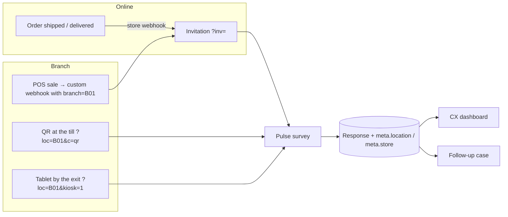

# Customer experience — تجربة العملاء

> **ملخص:** يقيس مِقياس تجربة العميل في **المتجر الإلكتروني** (بعد كل طلب، INTEGRATIONS.md) وفي **الفروع على أرض الواقع** (رمز QR عند الكاشير، جهاز لوحي عند المخرج، أو رابط على إيصال نقطة البيع) بالمؤشرات الثلاثة المعتمدة عالميًا — **NPS** و**CSAT** و**CES** — في تجربة «نبض» سريعة (سؤال واحد في كل شاشة، أقل من دقيقة). ثم يحدد **ما الذي يحرّك رأي العملاء** (تحليل المحركات الرئيسية) ويفتح **حالة متابعة** لكل عميل غير راضٍ تُغلق خلال 48 ساعة (الحلقة المغلقة). كل رقم تحسبه المنصة لا النموذج اللغوي، والقيم الأقل من 5 تقييمات مخفية.

## 1. The three measures

| Measure | Question | Score | Notes |
|---|---|---|---|
| **NPS** (Net Promoter Score) | «ما مدى احتمال أن توصي بنا…؟» 0–10 | % promoters (9–10) − % detractors (0–6), −100…+100 | 95% interval from the normal approximation of the promoter−detractor indicator; flagged «عينة صغيرة» below n = 10 |
| **CSAT** (customer satisfaction) | «ما مدى رضاك عن…؟» 1–5 (faces in pulse mode) | % answering 4–5 (top-2 box) + mean | |
| **CES** (customer effort) | «كان إنجاز … سهلًا» 1–7 | % answering 5–7 ("easy") + mean | Gartner-style 7-point agreement |

- The headline question of each type is the one marked **outcome** (`settings.cx_role = "outcome"`), else the first of that type that is not a profile question.
- Every figure (overall, per branch, per channel, per week) is hidden below **k = 5** answers (`{masked: true, n}`) — never estimated.
- Net Promoter®, NPS® and Net Promoter Score® are registered trademarks of Bain & Company, Inc., NICE Systems, Inc. and Fred Reichheld; the page footer says so.

## 2. Collection channels

- **Branches & service points** (`store_locations`): name, city, kind (`BRANCH|KIOSK|COUNTER|EVENT|OTHER`) and a short **code** unique per project (generated `B01`, `B02`… when empty; immutable because it is printed in QR codes). Paused or deleted codes are ignored, so a printed QR keeps working as a plain link.
- The survey page reads `?loc=`: the branch name fills `{{branch}}` (fallback «فرعنا» / "our branch") and the response keeps a **snapshot** `metadata.location = {id, code, name, kind, city}` — renaming a branch later does not rewrite history.
- **QR codes** per branch: `GET /surveys/{id}/qr.svg|png?loc=B01[&kiosk=true]`; a printable sheet of four 88 × 125 mm table-tent cards per A4 page (`/projects/{id}/integrations/cards`).
- **POS / till systems** send the branch code with the sale to a *Custom* store connection (`order.branch` or `order.location`); the invitation carries the location and the answer is credited to the branch (INTEGRATIONS.md §9).
- **Channel split** on the dashboard: `branch` (anything with a location: QR, kiosk or POS receipt), `online` (store invitations without a location), `other` (general links).

## 3. Pulse experience (`settings.experience = "pulse"`)

Designed for a customer standing at a till or walking out of a branch:

- One question per screen, a segmented progress bar, a short fade between steps (reduced-motion aware).
- **Faces** for CSAT, large **stars** for STAR, a colored 0–10 strip for NPS, large pills for choices. A **tap** moves on automatically (≈0.3 s); keyboard users press *Next* (no auto-advance on arrow keys, so nobody skips a question by accident).
- Adaptive closing (`_closing` in the templates): NPS ≤ 8 → «ما أهم شيء نحسّنه؟»; NPS ≥ 9 → «ما الذي أعجبك؟»; NPS ≤ 6 → «هل تود أن نتواصل معك؟» → phone field only on «نعم».
- Thank-you screen with an optional **reward** (`settings.reward_text`, e.g. a discount code).
- Ready-made: **«قيّم زيارتك» (`store_visit`)** — CSAT, five drivers (staff, checkout, availability, cleanliness, value), NPS and the adaptive closing; `store_experience` and `product_feedback` (online) use the same pulse settings.
- **Response quality** is calibrated for taps: rating and choice questions expect 2.5 s each (minimum 8 s per response) instead of 5–8 s on classic forms, and straight-lining is not flagged — all-top or all-bottom ratings are how delighted or upset customers rate, and hiding them would hide the detractors the closed loop exists for. A tap-through under a fifth of that time is still flagged. The builder's duration estimate uses the same calibration — 2.5 s per tap, 20 s per comment, half weight for questions shown only to some respondents — so the branch-visit survey reads «≈ 1 دقيقة», and the length check targets about a minute.

### Kiosk mode (`?kiosk=1`)

A shared tablet must never leak one customer's answers to the next: no saved progress in the browser, no device id (`client_id`), no "already answered" notice, a **fresh session per customer**, a welcome screen, return to it after **75 s** idle, and an automatic restart **8 s** after the thank-you screen. Channel = `KIOSK`.

## 4. Key driver analysis — «ما الذي يحرّك رأي العملاء؟»

- **Outcome**: the NPS headline question (else CSAT). **Drivers**: scale questions marked `cx_role = "driver"` in the builder.
- **Performance** = the driver's mean rescaled to 0–100. **Importance** = Spearman correlation between the driver and the outcome over respondents who answered both; computed only with **≥ 30 pairs** (`min_pairs`), otherwise the driver is listed as «بانتظار تقييمات كافية».
- **Quadrants** split at the medians of importance and performance among scored drivers: **fix** «أصلح أولًا» (important, lower performance), **keep** «حافظ عليه», **maintain** «قوة إضافية» (performs well, weaker link), **monitor** «راقبه».
- The page says plainly that correlation is not causation; the table view gives r, p and the number of pairs for every driver.

## 5. Closed loop — «المتابعة مع العملاء غير الراضين»

- Enabled per survey (`settings.closed_loop`, on in the ready-made templates). A response opens one **case** when NPS ≤ 6 (`DETRACTOR`), else CSAT ≤ 2 (`LOW_SATISFACTION`), else CES ≤ 3 (`HIGH_EFFORT`). Test orders and `LOW_QUALITY` responses never open cases.
- **SLA 48 h** (`due_at`); the dashboard reports open, overdue, share closed on time and the median time to close.
- **Contact only with consent**: a short-text question marked `contact_field = phone|email` is validated (Arabic-Indic digits normalized; phone `+?[0-9]{8,15}`), **removed from the answers** and stored only inside the case, **encrypted** (Fernet). It is revealed on demand (audited `cx.contact_reveal`) and **erased when the case is resolved**. When no case opens (the score is not low, or the closed loop is off) the contact is discarded — the builder warns when a contact field sits in a survey without the closed loop.
- Resolving requires a short note (what was learned and done). Cases can be taken («تولَّ الحالة») and reopened.
- Permissions: everyone with `analytics.read` sees the cases (reason, score, branch — no customer words); acting on a case, reading the customer's comment and revealing the contact require `responses.read_raw`.

## 6. Dashboard (`/projects/{id}/cx`)

KPI tiles (NPS with its interval and promoter/passive/detractor split, CSAT, CES) → follow-up cases → key-driver matrix → branch comparison (ranked, masked cells marked) → channel split → weekly trend (one measure at a time on a fixed axis: −100…100 for NPS, 0–100% otherwise; every chart has a table view). Every customer's words stay in the existing text analysis («ماذا يقول العملاء» links to Insights).

## 7. API

| Method | Path | Notes |
|---|---|---|
| GET/POST | `/projects/{id}/locations` | list (`project.read`) · create (`project.write`; `code` optional, 409 `location_code_taken`) |
| PATCH/DELETE | `/locations/{id}` | name, city, kind, `is_active` · delete (past answers keep their snapshot) |
| GET | `/surveys/{id}/qr.{svg,png}?loc=&kiosk=` | the branch's QR code |
| GET | `/projects/{id}/cx` | `{has_cx, overall, locations[], channels{}, weekly[], drivers{outcome, items[], min_pairs}, cases{open, overdue, resolved, within_sla_pct, median_hours}, k_anonymity}` |
| GET | `/projects/{id}/cx/cases?status=open\|resolved\|all` | newest first (200 max) |
| PATCH | `/cx/cases/{id}` | `{assign_to_me?, status?, resolution_note?}` (`responses.read_raw`; 422 `resolution_note_required`) |
| POST | `/cx/cases/{id}/contact` | `{phone?, email?}` — audited |
| GET | `/public/surveys/{public_id}?loc=` | `location: {code, name}` when the code is active |
| POST | `/public/surveys/{public_id}/responses` | `{…, channel: KIOSK?, location?}` |

## 8. Demo data

Development databases get **«تجربة عملاء متاجر الريحان (تجريبي)»** in the demo organization (`app/seed/demo_cx.py`, `is_demo`): three branches, ten weeks of pulse visits by QR and tablet, staff courtesy as the strongest driver, slow checkouts at «فرع الحمراء» until an extra cashier in week 7, and follow-up cases at every stage (fictitious 05000… numbers).

## 9. Later

- Sending follow-ups and invitations by WhatsApp/SMS through a paid provider (the invitation and case lifecycles are ready).
- Alerts (e-mail/Slack) when a case is opened or becomes overdue; per-branch owners.
- Benchmarks across organizations (needs opt-in and enough tenants for k-anonymity).
- Official POS integrations (Foodics, Square, Lightspeed) with OAuth — the custom webhook already accepts their sales via middleware.
