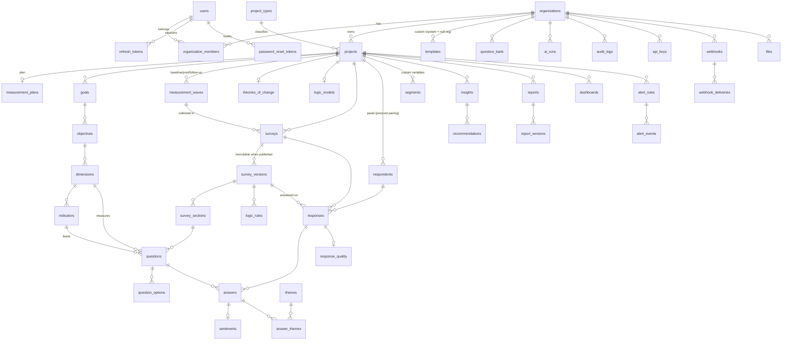

# Database

> **ملخص:** PostgreSQL 16. كل جدول يخص مؤسسة يحمل `organization_id` لعزل البيانات (Tenant Isolation). المفاتيح UUIDv7 (مرتبة زمنيًا). الحقول المرنة JSONB مع تحقق Pydantic قبل الكتابة. الترحيلات عبر Alembic، ولا يُعدَّل أي استبيان منشور — بل تُنشأ نسخة جديدة.

## 1. Conventions

| Convention | Rule |
|---|---|
| Primary keys | `id UUID` generated in the app as **UUIDv7** (time-ordered → index locality) |
| Timestamps | `created_at`, `updated_at` — `timestamptz`, UTC |
| Tenancy | every tenant-owned row has `organization_id UUID NOT NULL` + index; services always filter by it |
| Enums | stored as `VARCHAR` + `CHECK`-free (validated by Pydantic/SQLAlchemy `Enum(native_enum=False)`) → adding a value never needs a DB type migration |
| Flexible structures | `JSONB`, always validated by a Pydantic model before write |
| Soft delete | only where business requires (`archived_at`); privacy deletions are **hard** deletes |
| Demo data | `is_demo BOOLEAN` on organizations/projects/surveys/responses |
| Naming | snake_case, plural table names, FK `<entity>_id`, index `ix_<table>_<cols>`, unique `uq_<table>_<cols>` |
| Migrations | Alembic, one revision per phase/feature, reviewed before commit; `alembic upgrade head` on deploy |

## 2. ERD (V1 target)



### Measurement chain (the spine of the product)

```
Goal → Objective → Dimension → Indicator → Question → Answer → Analysis → Insight(evidence) → Recommendation
```

`questions.dimension_id` and `questions.indicator_id` are what make analytics, pre/post comparison and evidence traceability possible.

## 3. Tables

### 3.1 Identity & tenancy (Phase 1)

**users** — `id, email (unique, lower-cased), password_hash (argon2id), full_name, locale, is_active, is_superuser, email_verified_at, last_login_at, created_at, updated_at`

**organizations** — `id, name, slug (unique), sector, locale, timezone, settings JSONB, is_demo, created_at, updated_at`
`settings` example: `{ "ai": { "allow_cloud_ai": true, "followup_limit": 2 } }`

**organization_members** — `id, organization_id, user_id, role (OWNER|ADMIN|EDITOR|ANALYST|VIEWER), invited_by_id, created_at` · `uq(organization_id, user_id)`

**refresh_tokens** — `id, user_id, family_id, token_hash (sha256, unique), expires_at, revoked_at, replaced_by_id, user_agent, ip_hash, created_at`
Rotation: each refresh issues a new token and revokes the old one; presenting a revoked token revokes the **whole family** (reuse detection).

**password_reset_tokens** — `id, user_id, purpose (RESET|ACTIVATE), token_hash (unique), expires_at, used_at, created_by_id? (the administrator who prepared it), created_at` — one-time links that set a password (SUBSCRIPTIONS.md §4); a new link of the same purpose marks the earlier unused ones as used.

### 3.2 Projects & measurement plan (Phase 1–2)

**project_types** (reference, seeded) — `code PK (MeasurementType), name_ar, name_en, description_ar, description_en, evidence_level, default_design, requires_baseline, sort_order`

**projects** — `id, organization_id, title, description, measurement_type, sector, target_population, status (DRAFT|ACTIVE|COMPLETED|ARCHIVED), created_by_id, is_demo, starts_on, ends_on, settings JSONB, created_at, updated_at, archived_at`

**measurement_plans** — `id, organization_id, project_id (nullable until accepted, unique), status (DRAFT|ACCEPTED), source_prompt, language, draft JSONB, ai_output JSONB, ai_run_id, project_title, measurement_type, target_population, purpose, recommended_design, design_rationale, evidence_level, baseline_required, post_measurement_required, follow_up_recommended, follow_up_days, recommended_questions_count, estimated_completion_minutes, methodology_notes JSONB, created_by_id, accepted_at, created_at, updated_at`
- Before acceptance `draft` is the editable proposal (validated by the `MeasurementPlanDraft` schema).
- `ai_output` is the **original, immutable** AI proposal → traceability of "what AI suggested vs. what the user decided".
- On acceptance the lists are materialized into `goals/objectives/dimensions/indicators/measurement_waves` which become the source of truth.

**goals** — `id, organization_id, project_id, statement, description, sort_order`
**objectives** — `id, organization_id, project_id, goal_id, title, description, sort_order`
**dimensions** — `id, organization_id, project_id, objective_id?, key (unique per project), name, description, construct, sort_order`
**indicators** — `id, organization_id, project_id, dimension_id?, code, name, description, measurement_type, indicator_type (PERCENTAGE|AVERAGE_SCORE|COUNT|RATE|CHANGE|DIFFERENCE|EFFECT_SIZE|CUSTOM), formula, computation JSONB, unit, direction, target_value, baseline_value, current_value, source, frequency, owner, status, last_computed_at, sort_order, created_at, updated_at`
**measurement_waves** — `id, organization_id, project_id, wave_type (BASELINE|MIDLINE|POST|FOLLOW_UP|SINGLE), name, sort_order, planned_date, offset_days, status`
**theories_of_change** — `id, organization_id, project_id (unique), inputs, activities, outputs, short_term_outcomes, medium_term_outcomes, long_term_impact, assumptions, risks (JSONB arrays), indicator_links JSONB, ai_generated`
**logic_models** — `id, organization_id, project_id (unique), nodes JSONB, edges JSONB`

### 3.3 Survey engine (Phase 3)

**surveys** — `id, organization_id, project_id, wave_id?, title, description, status (DRAFT|PUBLISHED|PAUSED|CLOSED|ARCHIVED), public_id (unique, URL-safe), anonymity_mode (ANONYMOUS|IDENTIFIED|PSEUDONYMOUS), language, current_version_id, published_version_id, settings JSONB, opens_at, closes_at, response_limit, created_by_id, is_demo, created_at, updated_at`
**survey_versions** — `id, organization_id, survey_id, version_number, status (DRAFT|PUBLISHED|RETIRED), title, introduction, thank_you_message, settings JSONB, published_at, created_by_id, created_at` · `uq(survey_id, version_number)`
**survey_sections** — `id, organization_id, survey_version_id, key, title, description, sort_order, randomize_questions`
**questions** — `id, organization_id, survey_version_id, section_id, key, lineage_id, type, text, description, required, dimension_id?, indicator_id?, scale JSONB, validation JSONB, settings JSONB, scoring JSONB, ai_generated, sort_order`
- `key` is stable across versions **and across waves** (baseline/post use the same key for the same item) → item-level pre/post comparison.
- `lineage_id` follows a question through versions.

**question_options** — `id, organization_id, question_id, label, value, score, sort_order, is_other, is_exclusive`
**logic_rules** — `id, organization_id, survey_version_id, question_id?, section_id?, rule_type (DISPLAY|SKIP|BRANCH|END|QUOTA), condition JSONB, action JSONB, sort_order, enabled`

### 3.4 Responses (Phase 4)

**respondents** — `id, organization_id, project_id, code_hash? (keyed HMAC of the normalized pseudonymous code — never the code), email_hash?, label (e.g. R-7F3K2A), name_encrypted?, email_encrypted?, attributes JSONB, is_demo, created_at` · `uq(project_id, code_hash)`, `uq(project_id, email_hash)` — links the same person across waves for **paired** pre/post analysis without storing identity.
**responses** — `id, organization_id, project_id, survey_id, survey_version_id, wave_id?, respondent_id?, session_id (signed session id, uq with survey_id → idempotent submit), status (IN_PROGRESS|COMPLETED), started_at, completed_at, duration_seconds, channel (LINK|QR|EMBED|IMPORT|DEMO), locale, device (mobile|tablet|desktop|unknown), metadata JSONB (allow-listed), dedupe_hash? (keyed hash of a random browser id), answered_count, quality_score, quality_status (VALID|SUSPICIOUS|LOW_QUALITY), quality_flags JSONB, review_status (NONE|KEEP|EXCLUDE), reviewed_by_id?, reviewed_at?, is_demo, created_at` — the planned `response_quality` table is folded into these columns (1:1).
**answers** — `id, organization_id, response_id, survey_id, question_id?, question_key, lineage_id?, row_key?, value JSONB, numeric_value, text_value, is_followup, followup_prompt, created_at` — one row per (response, question, matrix-row); numeric/text projections make analytics SQL-friendly; `(survey_id, question_key)` indexed.
**files** — `id, organization_id, storage_key, original_name, content_type, size_bytes, sha256, purpose, created_by_id, created_at`

### 3.4b Store connections (INTEGRATIONS.md)

**store_connections** — `id, organization_id, project_id, platform (SALLA|ZID|SHOPIFY|WOOCOMMERCE|CUSTOM), name, store_url?, public_id (webhook id, unique), secret_encrypted, secret_hint, status (ACTIVE|PAUSED), store_survey_id?, product_survey_id?, trigger (FULFILLED|DELIVERED), delivery (LINK|EMAIL), delay_days, max_products, min_days_between, created_by_id?, last_event_at?, events_received, events_rejected, created_at, updated_at`
**store_events** — `id, organization_id, connection_id, event, status (ACCEPTED|DUPLICATE|IGNORED|REJECTED), reason, order_hash?, items, invitations_created, is_test, created_at` — no payloads; kept 30 days.
**survey_invitations** — `id, organization_id, project_id, survey_id, connection_id?, token (unique), order_hash, customer_hash?, product_key ("" = store experience), context JSONB (store, product), status (READY|SCHEDULED|SENT|OPENED|RESPONDED|EXPIRED|CANCELLED|OPTED_OUT), email_encrypted? (until sent), locale, send_at?, sent_at?, opened_at?, responded_at?, expires_at, is_test, created_at` · `uq(survey_id, order_hash, product_key)`
**store_opt_outs** — `id, organization_id, connection_id, customer_hash, created_at` · `uq(connection_id, customer_hash)`
**responses.invitation_id** — unique FK → one response per invitation; store answers have `channel = STORE`.

### 3.4c Customer experience (CX.md)

**store_locations** — `id, organization_id, project_id, code (uq per project; used in ?loc= and by POS), name, city, kind (BRANCH|KIOSK|COUNTER|EVENT|OTHER), is_active, created_at, updated_at` — responses keep a snapshot in `metadata.location = {id, code, name, kind, city}`.
**cx_cases** — `id, organization_id, project_id, survey_id, response_id (unique), location_id? (SET NULL), reason (DETRACTOR|LOW_SATISFACTION|HIGH_EFFORT), score, score_type (NPS|CSAT|CES), status (OPEN|IN_PROGRESS|RESOLVED), contact_requested, contact_encrypted? (Fernet JSON {phone?, email?}; erased on resolve), assigned_to_id?, due_at (+48 h), resolved_at?, resolution_note, created_at, updated_at`.
**responses.channel** adds `KIOSK`.

### 3.4d Gifts (GIFTS.md)

**gifts** — `id, created_by_id? (admin), organization_id? (SET NULL — kept as history), user_id? (SET NULL), recipient_name, recipient_email, note, locale, survey_limit, trial_days?, new_account, status (PENDING|ACTIVE|REVOKED), token_hash? (SHA-256 of the one-time activation token, unique), token_expires_at?, emailed_at?, activated_at?, created_at, updated_at`.
The gifted workspace's limits and trial dates live on its subscription (§3.4e).

### 3.4e Subscriptions (SUBSCRIPTIONS.md)

**subscription_plans** — `id, code (unique), name_ar, name_en, description_ar, description_en, is_trial, default_days?, max_surveys?, max_responses_per_month?, max_members?, ai_daily_tokens? (NULL = platform default), features JSONB (cx|integrations|exports|ai_analysis|ai_followup), is_archived, sort_order, created_at, updated_at` — reference data, no foreign keys.
**subscriptions** — `id, organization_id (unique, CASCADE), plan_id (RESTRICT), period_started_at? (NULL = waits for the owner's activation), period_ends_at? (NULL = no end), pending_days?, surveys_used, overrides JSONB, suspended_at?, suspension_reason, admin_note, notices JSONB, updated_by_id?, created_at, updated_at`. The state (PENDING|TRIAL|ACTIVE|EXPIRED|SUSPENDED) is derived, never stored.
**usage_monthly** — `organization_id + month (YYYY-MM, workspace time zone) PK, responses` — an atomic counter of the answers received.
Migration 0010 moved `organizations.survey_limit / surveys_published / trial_ends_at / ai_daily_token_limit` (0009) into subscriptions.
**users.is_superuser** = platform administrator (granted only with `pnpm admin grant`).

### 3.5 Analytics & intelligence (Phase 5–6)

**segments** — `id, organization_id, project_id, key, label, source (QUESTION|ATTRIBUTE|METADATA), question_key?, data_type, values JSONB`
**text_analyses** — `id, organization_id, project_id, question_key (unique per project), answers_total, answers_analyzed, keywords JSONB (snapshot), parts JSONB (status per part), analyzed_at, created_by_id, created_at, updated_at`
**answer_sentiments** — `id, organization_id, answer_id (unique), label (POSITIVE|NEUTRAL|NEGATIVE|MIXED), score, confidence, model, created_at`
**themes** — `id, organization_id, project_id, question_key, key, name, description, category (TOPIC|PAIN_POINT|STRENGTH|SUGGESTION), sentiment, keywords JSONB, mention_count, sort_order, ai_run_id, created_at`
**answer_themes** — `answer_id, theme_id` (PK both)
**insights** — `id, organization_id, project_id, kind, fingerprint (unique per project), title, body, severity, confidence, evidence JSONB, status (NEW|PINNED|DISMISSED), current, sort_order, created_at, updated_at`
**recommendations** — `id, organization_id, project_id, insight_ids JSONB, problem, recommendation, possible_cause, expected_outcome, priority, confidence, owner, timeframe, due_on, status (PROPOSED|ACCEPTED|IN_PROGRESS|DONE|DISMISSED), source (AI|MANUAL), ai_run_id, created_by_id, created_at, updated_at`
**dashboards** — `id, organization_id, project_id, name, layout JSONB, is_default`
**alert_rules** / **alert_events** — threshold, trend, response-rate, negative-sentiment alerts.

### 3.6 Reports (Phase 7)

**reports** — `id, organization_id, project_id, report_type (EXECUTIVE|DETAILED|IMPACT|MANAGEMENT|ACADEMIC), tone (FORMAL|PLAIN|ANALYTICAL), language, title, audience, current_version (int), created_by_id, created_at, updated_at`
**report_versions** — `id, organization_id, report_id, version_number (unique per report), reason (generated|refreshed|edited), content JSONB, data_snapshot JSONB, ai_run_id, created_by_id, created_at` — immutable; `content` holds the rendered sections, `data_snapshot` the counts, waves, evidence level and the full facts list used → reports are reproducible and auditable.

### 3.7 Platform

**templates** — not a table: system templates are defined in code (`app/domain/library/templates.py`, LIBRARY.md); organization templates are a later addition.
**question_bank** — `id, organization_id, question_type, text, construct, language, tags JSONB, question JSONB (the question document without key/lineage/links), created_by_id, created_at, updated_at` — organization items only; system items are defined in code.
**indicator_values** — `id, organization_id, project_id, indicator_id, wave (unique with indicator), value, n, reason, computed_at` — the last computed value of each indicator per wave (MEASUREMENT_ENGINE §6).
**ai_runs** — `id, organization_id?, user_id?, agent, provider, model, input_hash, prompt_tokens, completion_tokens, total_tokens, latency_ms, status (SUCCESS|REPAIRED|CACHED|FAILED), attempts, error_code, error_message, entity_type, entity_id, created_at` — **never** stores prompts or respondent data.
**audit_logs** — `id, organization_id?, actor_user_id?, action, entity_type, entity_id, metadata JSONB, ip_hash, user_agent, created_at`
**api_keys** — `id, organization_id, name, prefix, key_hash, scopes JSONB, created_by_id, last_used_at, expires_at, revoked_at, created_at`
**webhooks** — `id, organization_id, url, events JSONB, secret_encrypted, is_active, failure_count, last_delivery_at, created_by_id, created_at`
**webhook_deliveries** — `id, organization_id, webhook_id, event, payload JSONB, status, attempts, response_status, next_retry_at, created_at`

## 4. Indexing strategy

- `(organization_id)` on every tenant table; composite `(organization_id, project_id)` on high-volume tables.
- `responses (survey_id, status, created_at)`, `answers (question_id)`, `answers (response_id)`.
- `surveys (public_id)` unique; `refresh_tokens (token_hash)` unique.
- JSONB GIN indexes only where filtered (`responses.segment`).

## 5. Versioning rule

A survey version with `status = PUBLISHED` is **immutable**. Editing a published survey copies it into a new `DRAFT` version (`version_number + 1`, same `key`/`lineage_id` per question). Publishing the draft retires the previous version. Responses always reference the exact `survey_version_id` they were collected on.

## 6. Privacy & deletion

- Organization export: JSON/CSV of all tenant data.
- Organization delete: hard-deletes all tenant rows (FK `ON DELETE CASCADE` from `organizations`).
- Respondent delete: removes respondent + responses + answers.
- Encrypted columns (`*_encrypted`) use Fernet with `ENCRYPTION_KEY`.
