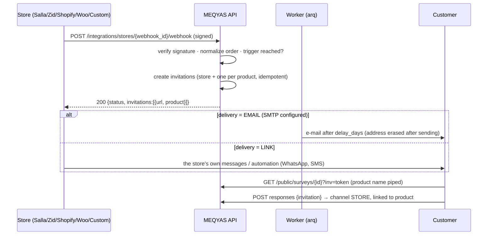

# Store integrations — ربط المتاجر الإلكترونية

> **ملخص:** يربط مِقياس متجرًا إلكترونيًا (سلة، زد، Shopify، WooCommerce أو أي نظام يرسل طلبًا موقّعًا) بمشروع قياس. كل طلب يُشحن أو يُسلَّم يتحول إلى **دعوات تقييم أحادية الاستخدام**: واحدة لتجربة المتجر، وواحدة لكل منتج مختلف في الطلب. الإجابات تُربط بالمنتج والمتجر فتظهر نتائج الرضا وNPS **حسب المنتج** في التحليلات. لا يتطلب أي خدمة مدفوعة.

## 1. Flow



## 2. Platforms

| Platform | Where the webhook is configured | Verification | Order stage used |
|---|---|---|---|
| **Salla (سلة)** | Free private app in the Salla Partners portal → Webhooks, event `order.status.updated` | `X-Salla-Signature` = hex HMAC-SHA256(secret, raw body) with strategy *Signature*; or strategy *Token* (`Authorization` = secret) | status slug `delivered` → delivered; `completed`/`shipped`/`delivering` → fulfilled; `canceled`/`restored` → cancelled |
| **Zid (زد)** | Private app in the Zid Partner dashboard → `POST /v1/managers/webhooks`, event `order.status.update` (optional condition `status=delivered`) | HTTP Basic: username `meqyas`, password = secret (mandatory Basic auth) | `order_status.code`: `indelivery` → fulfilled, `delivered` → delivered, `cancelled`/`reversed` → cancelled |
| **Shopify** | Settings → Notifications → Webhooks: *Order fulfillment* (or *Fulfillment update* for delivery) | `X-Shopify-Hmac-Sha256` = base64 HMAC-SHA256 — the secret is Shopify's signing key (pasted into MEQYAS) | `orders/fulfilled` → fulfilled; `fulfillments/update` with `shipment_status=delivered` → delivered; `orders/cancelled` |
| **WooCommerce** | WooCommerce → Settings → Advanced → Webhooks, topic *Order updated*, Secret = MEQYAS secret | `X-WC-Webhook-Signature` = base64 HMAC-SHA256; the URL-check ping (`webhook_id=…`) is answered without side effects | `completed` → delivered; `processing` → paid; `cancelled`/`refunded`/`failed` → cancelled |
| **Custom** | Any system | `X-Meqyas-Signature: t=<unix>,v1=<hex HMAC-SHA256(secret, "<t>." + body)>`, ±5 minutes | `order.status` ∈ created/paid/fulfilled/delivered/cancelled |

Custom body:

```json
{
  "event": "order.delivered",
  "order": {
    "id": "1001",
    "status": "delivered",
    "locale": "ar",
    "customer": { "id": "c-77", "email": "customer@example.com" },
    "items": [{ "id": "p-12", "name": "Product name", "sku": "SKU-12", "quantity": 1 }]
  }
}
```

Adapters live in `apps/api/app/domain/stores.py` (pure functions, unit-tested per platform). Unknown statuses or payload variants are **ignored** (logged), never crash the webhook; verified-but-unreadable payloads return 200 so platforms don't disable the webhook.

## 3. Invitations

- **Trigger** per connection: `FULFILLED` (on shipping) or `DELIVERED` (on delivery/completion). Earlier stages are logged as `before_trigger`.
- **Targets**: the *store experience* survey → one invitation per order; the *product* survey → one per distinct product (variants share one), up to `max_products` (default 3).
- **Idempotent**: unique `(survey, order, product)` — re-deliveries are `DUPLICATE`.
- **Cancelled/refunded orders** cancel their open invitations.
- **Fatigue guard**: a customer is invited at most once every `min_days_between` days (default 30). **Opt-out** from the survey page stops all future requests from that store for that customer.
- **Expiry**: 60 days (plus the e-mail delay).
- **Single use**: the response is unique per invitation; a used link shows a thank-you page.
- **Piping**: `{{store}}`, `{{product}}` and `{{branch}}` in question texts, titles, descriptions and option labels are filled from the invitation or the branch link (fallback «المتجر» / «المنتج» / «فرعنا»).
- **Ready-made surveys**: `store_experience` (CSAT, on-time delivery, packaging, ordering ease (CES), support, NPS, adaptive closing), `product_feedback` (CSAT, as described, value for money, NPS, adaptive closing) and `store_visit` for branches — editable drafts in the pulse experience with follow-up cases on (CX.md).
- **Test order**: runs a sample order through the same pipeline; test invitations and their answers never count in analytics or exports.

## 4. Delivery (no paid services by default)

| Mode | What happens |
|---|---|
| `LINK` (default) | Links are returned in the webhook response (for Zapier/Make/n8n/custom code that sends WhatsApp/SMS through the merchant's own provider) and listed in the connection's *Invitations* tab (copy & share). |
| `EMAIL` | Needs `SMTP_URL`. The worker (`send_store_invitations`, every minute) e-mails the customer `delay_days` after the trigger, then **erases the address**. Three failed attempts fall back to `READY`. |

## 5. Analytics

Store answers have `channel = STORE` and `metadata.store = {connection_id, name, platform, product_key, product_name, test}`. The analytics dataset adds two segment variables, **product** and **store** (Questions breakdown and Cross-tabs), shown once store answers exist; `summary.channels` and `summary.products` report the mix. k-anonymity (n < 5) applies to products like any other segment. Connection cards show invitations, opened, answered and the **response rate** (answered ÷ invitations that reached the customer; cancelled ones excluded).

## 6. Security & privacy

- Managing connections requires `integrations.manage` (admins/owners); everyone in the project sees status and counts; invitation links (capability URLs) require `responses.read_raw`.
- Secrets are stored **encrypted** (Fernet, `ENCRYPTION_KEY`), shown once at creation/rotation, then only their last 4 characters. Rotation and deletion are audited.
- Every delivery is verified in constant time; bad signatures are counted and logged (`REJECTED`) without the payload. Rate limits: 600/min per connection, 1200/min per IP; body ≤ 512 KB.
- **No webhook payload is stored.** Order and customer ids are keyed hashes (`stable_hash`); no names or phone numbers are kept; the e-mail address exists only encrypted until the invitation is sent (or opened/answered/cancelled), then is erased.
- The event log keeps 30 days.

## 7. API

| Method | Path | Notes |
|---|---|---|
| GET | `/integrations/capabilities` | `{email_delivery, webhook_base_url}` |
| GET/POST | `/projects/{id}/store-connections` | list (with stats) / create (returns `secret` once) |
| GET/PATCH/DELETE | `/store-connections/{id}` | details · settings/pause (`status`) · delete (audited) |
| POST | `/store-connections/{id}/secret` | `{secret?}` paste the platform's secret or generate one (returned once) |
| POST | `/store-connections/{id}/test` | sample order → test invitation links |
| GET | `/store-connections/{id}/events` | delivery log (status, reason) |
| GET | `/store-connections/{id}/invitations` | `?status` — links and lifecycle (`responses.read_raw`) |
| POST | `/projects/{id}/surveys/from-template` | `{template: store_experience|product_feedback|store_visit, language?}` |
| POST | `/integrations/stores/{webhook_id}/webhook` | public, signed — `{status: accepted|duplicate|ignored|ping|paused, reason, invitations}` |
| GET | `/public/surveys/{public_id}?inv=` | `invitation: {state: valid|used|expired|closed|invalid, store, product}` |
| POST | `/public/surveys/{public_id}/invitations/{token}/opt-out` | stop future requests from this store |

## 8. Later

Official one-click apps (Salla App Store, Zid App Market, Shopify App Store) with OAuth installation and automatic webhook registration need partner accounts and app review; the adapters and pipeline are ready for them. WhatsApp/SMS sending through a paid provider can plug into the same invitation lifecycle.

## 9. Branches & POS (CX.md)

Physical branches use the same surveys and analytics. A **location** (`/projects/{id}/locations`) gives each branch a short code; its QR code (`/surveys/{id}/qr.svg?loc=B01`), tablet link (`?loc=B01&kiosk=1`) and printable table cards live under **المتاجر والفروع → الفروع ونقاط الخدمة**.

A till or POS system that can call a webhook uses a **Custom** connection and adds the branch code to the sale:

```json
{
  "event": "order.completed",
  "order": { "id": "R-1001", "status": "completed", "branch": "B01", "items": [] }
}
```

`order.branch`, `order.location` or a top-level `location` are read; an active code adds the branch to the invitation (`{{branch}}` is piped) and to the response (`metadata.location`), so a POS receipt counts as a **branch** visit in the CX dashboard. Unknown codes are ignored.
