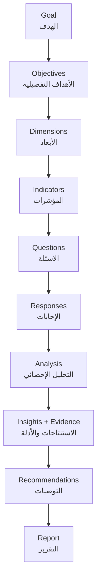

# Measurement Engine

> **ملخص:** محرك القياس هو «العقل المنهجي» للمنصة: يصنّف نوع القياس، يختار التصميم المناسب (بعدي فقط، قبلي/بعدي، متابعة…)، يحدد مستوى الدليل المسموح به، يبني سلسلة الهدف ← المؤشر ← السؤال، ويمنع المبالغة في ادعاء السببية.

## 1. The measurement chain



## 2. Measurement types → levels

Measurement types map to an outcome **level** (inspired by Kirkpatrick & results chains):

| Level | Types | What it answers |
|---|---|---|
| **Reaction** (ردّ الفعل) | SATISFACTION, PERCEPTION, EXPERIENCE, EVENT_EVALUATION, CUSTOMER_FEEDBACK, EMPLOYEE_PULSE | How did people feel about it? |
| **Need** (الاحتياج) | NEEDS_ASSESSMENT | What is missing / what should we do? |
| **Learning** (التعلّم) | AWARENESS, KNOWLEDGE, SKILLS | Did they learn / become able? |
| **Behavior** (السلوك) | BEHAVIOR, ENGAGEMENT | Do they do things differently? |
| **Results** (النتائج والأثر) | OUTCOME, IMPACT | Did the situation improve, and did the program contribute? |
| **Composite** (مركّب) | PROGRAM_EVALUATION, TRAINING_EVALUATION | Several levels together |
| **Design-centric** | PRE_POST, LONGITUDINAL | Defined by the timing of measurement |

## 3. Classification rules (the most important feature)

The Architect **must not over-classify**. Decision guide (encoded in the system prompt and verified after generation):

1. Request mentions satisfaction, opinion, impressions, experience (`رضا، انطباع، رأي، تجربة، تقييم النشاط`) and **does not** ask about change → **SATISFACTION / PERCEPTION / EXPERIENCE**. Design: `POST_ONLY`.
   *«أريد قياس رضا الطالبات عن النشاط»* → قياس رضا وانطباع.
2. Request asks whether something **improved/changed/had an effect** (`تحسن، تغير، أثر، فرق، هل أدى، هل ساهم، نتائج`) → **OUTCOME** or **IMPACT** with `PRE_POST` (or `PRE_POST_FOLLOW_UP` when persistence matters, e.g. behaviour/skills).
   *«أريد معرفة هل أدى البرنامج إلى تحسن فعلي»* → قبلي/بعدي (+ متابعة).
3. Request targets knowledge/skills of a training → **TRAINING_EVALUATION** (reaction + learning [+ behavior via follow-up]).
4. Request about what people need before designing an intervention → **NEEDS_ASSESSMENT** (single wave, before).
5. Recurring climate/pulse → **EMPLOYEE_PULSE / LONGITUDINAL** with `REPEATED` design.
6. When ambiguous → choose the **lower** level that satisfies the request and add a `clarifying_question` suggesting the higher level ("هل تريد أيضًا معرفة هل تحسّن الأداء فعليًا؟").

## 4. Designs and evidence levels

| Design | Waves | Evidence level | Allowed claim |
|---|---|---|---|
| `POST_ONLY` | SINGLE | **DESCRIPTIVE** | «أفاد 82% من المشاركين بأنهم راضون…» |
| `RETROSPECTIVE_PRE_POST` | SINGLE (then-test items) | **PERCEIVED_CHANGE** | «يرى المشاركون أن مستواهم ارتفع…» |
| `PRE_POST` | BASELINE → POST | **CHANGE** | «ارتفع المؤشر من 3.1 إلى 4.0 بعد البرنامج» |
| `PRE_POST_FOLLOW_UP` | BASELINE → POST → FOLLOW_UP | **CHANGE + PERSISTENCE** | «…واستمر الارتفاع بعد 30 يومًا» |
| `REPEATED` / `LONGITUDINAL` | N waves | **TREND** | «اتجاه تصاعدي عبر 4 قياسات» |
| `COMPARISON_GROUP` (roadmap) | treated vs comparison, pre/post | **CONTRIBUTION** | «تحسّن المشاركون أكثر من غير المشاركين» |
| RCT (out of scope) | randomized | **ATTRIBUTION** | causal claim |

**Causality guard:** for any design below `COMPARISON_GROUP`, generated narratives must use non-causal language. Mandatory caveat (AR):

> أظهرت النتائج ارتفاعًا في المؤشر بعد البرنامج، لكن هذا التصميم وحده لا يثبت أن البرنامج هو السبب الوحيد في هذا التغير.

Implemented in `meqyas_ai/measurement/causality.py` (detector for causal verbs: «تسبب، أدى إلى، بسبب البرنامج، caused, led to, resulted in…») + the report writer's post-processor which rewrites/flags such sentences.

## 5. Deterministic plan rules (post-processing)

Applied to every `MeasurementPlanDraft` (AI output or user edit):

| Rule | Effect |
|---|---|
| R1 design→waves | waves are derived from `recommended_design` (single source of truth) |
| R2 design→flags | `baseline_required`, `post_measurement_required`, `follow_up_recommended` follow the design |
| R3 type↔design | change types (OUTCOME, IMPACT, PRE_POST, KNOWLEDGE, SKILLS, BEHAVIOR) default to `PRE_POST` if model chose `POST_ONLY` (unless request is explicitly retrospective) — note added |
| R4 evidence level | computed from design, never taken from the model |
| R5 causality note | appended for change designs |
| R6 keys | dimension keys slugified & unique; indicator `dimension_key` must exist (else attached to closest/first dimension) |
| R7 counts | questions 5–60; minutes = clamp(round(questions × 0.35), 2, 30) when inconsistent |
| R8 follow-up days | default 30 (skills/behavior 30–90) when follow-up recommended |
| R9 over-claim check | reaction-level request + IMPACT type ⇒ flagged for repair |

## 6. Indicators

Fields: `name, description, dimension, measurement_type, indicator_type, formula, computation, unit, target, baseline, current_value, source, frequency, owner, status, direction`.

| Type | Formula | Typical use |
|---|---|---|
| `AVERAGE_SCORE` | mean of item scores (1–5) | satisfaction, confidence |
| `PERCENTAGE` | % respondents with score ≥ threshold (top-2-box) | "% satisfied" |
| `COUNT` | count of responses matching a condition | attendance, usage |
| `RATE` | count / eligible population | response rate, adoption rate |
| `CHANGE` | value(POST) − value(BASELINE); % change | pre/post |
| `DIFFERENCE` | value(group A) − value(group B) | segments |
| `EFFECT_SIZE` | Cohen's d (independent) / d_z (paired) | strength of change |
| `CUSTOM` | expression over other indicators | composite indices |

`computation` (machine-readable) example:

```json
{ "method": "mean", "question_keys": ["conf_1","conf_2","conf_3"], "scale_min": 1, "scale_max": 5,
  "compare": { "from_wave": "BASELINE", "to_wave": "POST" } }
```

Status: `NOT_STARTED | COLLECTING | ON_TRACK | AT_RISK | OFF_TRACK | ACHIEVED` — computed from current vs target with direction. `COLLECTING` means answers have arrived but fewer than the privacy minimum (k = 5), so no value is shown yet (the card says how many arrived); `NOT_STARTED` means no answers at all.

**Persisted values (Phase 8).** The analytics engine computes indicators live from the accepted responses
(questions are linked to an indicator by `question.indicator_id`). A question links to **one** indicator, so a dimension's second indicator — typically «% positive» next to the dimension's average — would never get questions: an indicator with no linked questions is therefore measured on its **dimension's** questions (`items_from: "dimension"`, shown on the card). `services/indicators.persist` stores the
result: `baseline_value`, `current_value`, `status` and `last_computed_at` on the indicator (a change or
effect size has no baseline of its own) and one `indicator_values` row per wave (value, n, reason when
withheld — e.g. `below_k_anonymity`). Values refresh whenever insights are generated (reports do this too)
or with `POST /projects/{id}/indicators/recompute`; recomputing upserts, never duplicates.

## 7. Waves (Pre/Post/Follow-up)

- `BASELINE` → before the intervention; `POST` → right after; `FOLLOW_UP` → N days after (default 30).
- Indicators are **shared** across waves; each wave has its own survey; repeated items share the same `question.key`.
- Pairing: if respondents enter the same pseudonymous code in each wave (`respondents.external_ref`), paired analysis (paired t-test, d_z) is used; otherwise independent-samples statistics are used and the report says so.
- **Repeated rounds** (`ROUND`, `MIDLINE`): when a project has several waves of a repeatable type, each is
  its own analysis wave (`ROUND-1`, `ROUND-2`, … in plan order) so rounds are compared, not merged; a
  single round keeps the plain key. Wave names come from the plan.
- **Copy to another wave** (`POST /surveys/{id}/copies`): a draft copy with the same question keys and
  lineage, so the new wave is comparable without rewriting the questionnaire.

## 8. Theory of Change & Logic Model (Impact projects)

`Inputs → Activities → Outputs → Short-term Outcomes → Medium-term Outcomes → Long-term Impact`, with `Assumptions`, `Risks`, and indicator links per outcome (`services/toc.py`).

- **Drafting**: TheoryOfChangeAgent (smart tier) reads the plan — purpose, objectives, dimensions,
  indicators, waves and optional notes, all as untrusted data — and links each outcome to the codes of the
  project's indicators. Unknown codes and empty chains trigger a repair round; it adds no numbers or
  targets. Codes are mapped to indicator ids on save.
- **Editing**: every list is editable; an outcome may link only to the project's own indicators
  (`422 unknown_indicator`). Saving rebuilds the logic model (`logic_models`): one node per item, column
  edges (`leads_to`) and outcome → indicator edges (`measured_by`).
- **Impact evidence**: the page shows, under each outcome, the persisted value and status of its linked
  indicators, a summary (linked indicators, how many achieved / on track / at risk / off track) and the
  evidence level's caveat — the data supports or questions each step of the hypothesis; it does not prove
  that the program caused the change unless the design allows attribution.

## 9. Code map

| Concern | Location |
|---|---|
| Enums (types, designs, evidence) | `packages/ai/meqyas_ai/domain/enums.py` (Python) · `packages/shared/src/enums.ts` (TS) |
| Plan schema | `packages/ai/meqyas_ai/schemas/plan.py` · `packages/shared/src/schemas/plan.ts` |
| Rules (post-processing) | `packages/ai/meqyas_ai/domain/plan_rules.py` |
| Intent signals | `packages/ai/meqyas_ai/domain/intent.py` |
| Causality guard | `packages/ai/meqyas_ai/domain/causality.py` |
| Persistence | `apps/api/app/services/plans.py` |
| Indicator values | `apps/api/app/services/indicators.py` |
| Theory of Change | `packages/ai/meqyas_ai/agents/theory_of_change.py` · `apps/api/app/services/toc.py` |
| Templates & bank | `apps/api/app/domain/library/templates.py` · `apps/api/app/services/library.py` (LIBRARY.md) |
