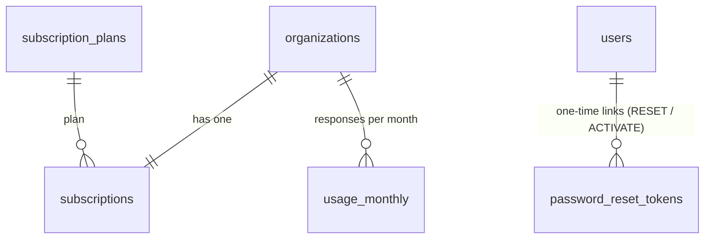

# Subscriptions & accounts — الاشتراكات وإدارة المشتركين

> **ملخص:** لا يوجد تسجيل ذاتي. مدير المنصة يُنشئ المشتركين من لوحة «المشتركون» (فرادى أو بالجملة)، أو يُهديهم حسابًا تجريبيًا (GIFTS.md)، ويستطيع مالك المساحة ومديرها دعوة فريقهما ضمن حدود الباقة. لكل مساحة عمل **اشتراك واحد**: باقة تحدد الحدود والوحدات، وحدود خاصة اختيارية، وفترة. حالة الاشتراك تُشتق من تواريخه (تجريبي، نشط، منتهٍ)، والإيقاف قرار من الإدارة. كلمة المرور لا تُرسل في أي رسالة: يختارها صاحب الحساب من **رابط تفعيل** لمرة واحدة، ومن نسيها يستعيدها بالبريد أو برابط استعادة يُعدّه له المدير.

This is phase 1 (no online payment). Phase 2 — prices, a payment gateway and tax invoices — builds on the same tables.

## 1. Model



| | |
|---|---|
| **Plan** (`subscription_plans`) | name (ar/en), trial flag, suggested length (`default_days`), limits, modules (`features`), archived flag. Edited from «الباقات»; a change applies at once to every workspace on the plan. Defaults (`app/domain/subscription.py`): تجريبية · أساسية · احترافية · مؤسسات. |
| **Subscription** (`subscriptions`) | one per workspace: plan, `period_started_at`, `period_ends_at` (NULL = no end), `pending_days` (the length of a period that starts when the owner activates the account), `surveys_used` (this period), `overrides` (the workspace's own limits), `suspended_at` + reason, internal `admin_note`, reminders already sent. |
| **Monthly usage** (`usage_monthly`) | answers received per workspace per calendar month (workspace time zone), an atomic counter. |

### Limits

| Limit | Counted | Enforced |
|---|---|---|
| `surveys` | first publication of a survey, per period (new versions are free; deleting is no refund; a renewal resets it) | publish → `409 survey_limit_reached` |
| `responses_per_month` | every submitted answer, per calendar month | public surveys show **closed** at the limit; a submission over it → `409 survey_closed` |
| `members` | memberships of the workspace (pending invitations included) | invitations / additions → `409 member_limit_reached` |
| `ai_daily_tokens` | tokens of all AI runs today | `429 ai_budget_exceeded` (`NULL` = the platform default `AI_DAILY_TOKEN_LIMIT_PER_ORG`; AI is never unlimited) |

Effective limit = the workspace's override if the key is present (`null` = unlimited), else the plan's. All counters are consumed atomically (`UPDATE … WHERE used < limit RETURNING`, `INSERT … ON CONFLICT … WHERE`) inside the business transaction, so concurrent requests cannot exceed a limit and a failed request gives the slot back.

## 2. States

Derived, never stored (`services/subscriptions.state_of`):

| State | When | Effect |
|---|---|---|
| `PENDING` | the owner has not activated the account | nothing yet (nobody can sign in); the period starts at activation |
| `TRIAL` / `ACTIVE` | period running (trial plans read TRIAL) | everything the plan includes |
| `EXPIRED` | `period_ends_at` passed | no publishing (`409 subscription_ended`), no AI (`409 ai_subscription_inactive`), no new members; published surveys keep collecting for `SUBSCRIPTION_GRACE_DAYS` (7), then close; results, exports and reports stay readable |
| `SUSPENDED` | an administrator suspended it | the workspace is closed: every workspace endpoint → `403 organization_suspended` (the app shows a suspended screen), public surveys closed, store orders ignored. Nothing is deleted; reactivating restores everything |

The app shows one calm banner: trial (surveys left, days left), ending within 14 days, ended, surveys used up, 80% / 100% of the month's answers.

## 3. Modules (features)

| Module | Where it is enforced |
|---|---|
| `cx` — customer experience & branches | the whole CX router (`403 feature_not_in_plan`); the CX tab and branch cards show a locked card |
| `integrations` — store integrations | store-connection endpoints; incoming store orders are acknowledged and ignored |
| `exports` — raw data exports | `GET /surveys/{id}/responses/export.*` |
| `ai_analysis` — AI analyst, recommendations, sentiment/themes, report narrative | by agent in `run_agent` (`403 ai_not_in_plan`); reports fall back to their computed sections, text analysis to keywords |
| `ai_followup` — adaptive follow-up questions | public surveys simply do not ask them |

Everything else (measurement plans, surveys, analytics, indicators, reports) is in every plan. The UI hides what the plan lacks; the API is the authority.

## 4. Accounts — no self-registration

- `POST /auth/register` and `POST /organizations` do not exist. `/register` redirects to sign-in.
- **Who creates accounts:** platform administrators (a subscriber — one or in bulk —, members added to any workspace, gifts) and a workspace's OWNER/ADMIN (inviting people to their own workspace, within the plan's members).
- **A new account has no usable password.** The message prepared for the person carries a one-time **activation link** (`/activate/{token}`, `ACTIVATION_LINK_TTL_DAYS` = 14). Only the token's SHA-256 is stored (`password_reset_tokens.purpose = ACTIVATE`); the message is returned once, e-mailed when SMTP is configured, and otherwise shared by WhatsApp or any channel. Activating sets the password, signs the person in and starts the subscription periods waiting for this owner.
- **Forgot password:** «نسيت كلمة المرور؟» e-mails a 30-minute link. Without e-mail, an administrator prepares a **recovery link** (`RESET`, `ADMIN_RESET_LINK_TTL_HOURS` = 24) and sends it by hand. A new link always cancels the previous one of the same kind; using one signs every session out.
- **Who may prepare links:** platform administrators for anyone. A workspace's OWNER/ADMIN only for members whose account belongs to **their workspace alone** (never for themselves, an owner if they are an admin, or a platform administrator) — so no workspace can take over an account another workspace relies on. Otherwise: `409 member_in_other_workspaces`.
- **Change password** (signed in): the current password is required; every other session is signed out.
- **Disable an account** (administrators): it cannot sign in anywhere and its sessions end at once; its data stays.
- **The first administrator** is created on the server: `pnpm admin create-admin someone@example.com "Full Name"` prints a one-time activation link. `pnpm admin link someone@example.com` prints a new activation or recovery link (e.g. for an administrator who lost access).

## 5. Platform administration

Pages: «المشتركون» (`/admin/subscribers`), a subscriber's page (`/admin/subscribers/{id}`), «الباقات» (`/admin/plans`), «الإهداءات» (`/admin/gifts`). Only for `users.is_superuser` (granted from the CLI only).

| Method | Path | |
|---|---|---|
| GET | `/admin/subscribers?q&state&plan&sort&include_demo&limit&offset` | every workspace: owner, plan, state, period, usage, last activity; counts per state (`ENDING_SOON` = within 14 days) |
| POST | `/admin/subscribers` | account (or existing account) + workspace + subscription + activation message (shown once) |
| POST | `/admin/subscribers/bulk` | one workspace per row (≤ 200), each row committed on its own; results per row |
| GET / PATCH | `/admin/subscribers/{org}` | detail (members, recent events) · plan, own limits, end date, internal note, name |
| POST | `/admin/subscribers/{org}/renew` | `{days, plan_code?}` — days added to what is left, survey counter reset |
| POST | `/admin/subscribers/{org}/suspend` · `/reactivate` | |
| POST / DELETE | `/admin/subscribers/{org}/members` · `/members/{member}` | add people (≤ 200, new accounts get activation messages) · remove |
| POST | `/admin/users/{user}/access-link` | activation link (never signed in) or recovery link |
| POST | `/admin/users/{user}/disable` · `/enable` | |
| GET / POST / PATCH | `/admin/plans` · `/admin/plans/{id}` | plans with their subscriber counts |

Every action is audited (`subscriber.*`, `subscription.*`, `member.*`, `user.*`, `plan.*`). The subscriber page lists the workspace's recent events.

## 6. Reminders

The worker e-mails the workspace's owners and admins once a day (09:00 Riyadh) when the period ends in 7 days or tomorrow, when it ended, and at 80% / 100% of the month's answers — each reminder once per period or month. Without SMTP nothing is sent; the banner says the same thing.

## 7. Configuration

```
ACTIVATION_LINK_TTL_DAYS=14
ADMIN_RESET_LINK_TTL_HOURS=24
SUBSCRIPTION_GRACE_DAYS=7
GIFT_PLAN=trial
AI_DAILY_TOKEN_LIMIT_PER_ORG=2000000   # plans without their own AI budget
NEXT_PUBLIC_CONTACT_URL=               # optional «تواصل معنا» on the sign-in page (mailto:, https://wa.me/…)
```

## 8. Upgrade (migration 0010)

Gifted workspaces move to the «trial» plan with their own survey limit and dates; every other workspace (including the demo) to «enterprise», so nothing changes on upgrade. Monthly usage is back-filled from existing answers. The downgrade restores the workspace columns of 0009.
