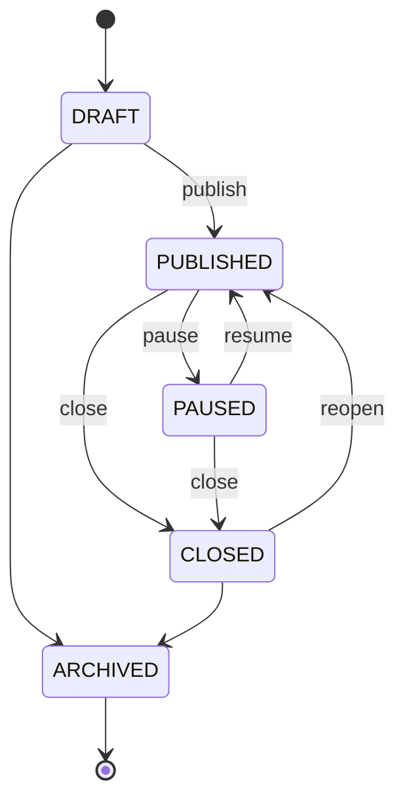

# Survey Engine

> **ملخص:** محرك الاستبيانات يدير: أنواع الأسئلة (19 نوعًا)، الأقسام، الخيارات والمقاييس، منطق التخطي والعرض والتفرّع، الإدخال الديناميكي (Piping)، العشوائية، الحصص، التحقق، النسخ (Versioning)، حالات النشر، أوضاع الخصوصية، وأسئلة المتابعة الذكية المحدودة.

## 1. Model

```
Survey (status, public_id, anonymity, wave)
 └─ SurveyVersion (immutable once PUBLISHED)
     ├─ Section (key, title, randomize_questions)
     │   └─ Question (key, type, text, required, dimension_id, indicator_id, scale, validation, settings, scoring)
     │       └─ Option (value, label, score, is_other, is_exclusive)
     └─ LogicRule (DISPLAY | SKIP | BRANCH | END | QUOTA)
```

## 2. Question types

| Type | Answer value (JSON) | numeric projection |
|---|---|---|
| `SHORT_TEXT` | `"text"` | — |
| `LONG_TEXT` | `"text"` | — |
| `SINGLE_CHOICE` | `"opt_value"` | option score |
| `MULTIPLE_CHOICE` | `["a","b"]` | count / scores |
| `DROPDOWN` | `"opt_value"` | option score |
| `RATING` | `4` | value |
| `STAR` | `4` | value |
| `LIKERT` | `4` (1..N) | value (reverse-scored if configured) |
| `MATRIX` | `{"row_key": "opt_value"}` | per-row score (one `answers` row per matrix row) |
| `RANKING` | `["c","a","b"]` | rank positions |
| `SLIDER` | `72` | value |
| `NPS` | `9` (0–10) | value; promoter/passive/detractor |
| `CSAT` | `4` (1–5) | value; % satisfied = 4–5 |
| `CES` | `5` (1–7) | value |
| `NUMBER` | `12.5` | value |
| `DATE` | `"2026-10-09"` | — |
| `FILE` | `{"file_id": "..."}` | — |
| `INFORMATION` | — (display only) | — |
| `SECTION` | — (page break / header) | — |

## 3. Question object

```json
{
  "id": "uuid",
  "key": "conf_ai_tools",
  "type": "LIKERT",
  "text": "أشعر بالثقة في استخدام أدوات الذكاء الاصطناعي في التعلّم",
  "description": "",
  "required": true,
  "dimension_id": "uuid",
  "indicator_id": "uuid",
  "options": [{ "value": "1", "label": "لا أوافق بشدة", "score": 1 }],
  "scale": { "min": 1, "max": 5, "min_label": "لا أوافق بشدة", "max_label": "أوافق بشدة", "reverse_scored": false },
  "logic": [],
  "validation": { "min_length": null, "max_length": 1000, "min": null, "max": null, "pattern": null },
  "settings": { "randomize_options": false, "allow_other": false, "rows": [], "ai_followup": false },
  "scoring": { "weight": 1, "correct_values": [] },
  "ai_generated": true
}
```

## 4. Logic engine

Implemented twice with identical semantics: **TypeScript** (`packages/shared/src/logic`) for instant client evaluation and **Python** (`apps/api/app/domain/survey/logic.py`) for server-side validation. Shared fixtures: `tests/fixtures/logic-cases.json` are executed by both test suites (parity guarantee).

### Condition grammar

```json
{ "all": [ { "question": "satisfaction", "op": "in", "value": [1, 2] },
           { "any": [ { "question": "grade", "op": "eq", "value": "10" },
                      { "question": "grade", "op": "eq", "value": "11" } ] } ] }
```

Operators: `eq, neq, in, not_in, gt, gte, lt, lte, contains, not_contains, answered, not_answered`.
Unanswered values never satisfy comparison operators (only `not_answered`).

### Rule types

| rule_type | action | semantics |
|---|---|---|
| `DISPLAY` | `{ "type": "SHOW" }` on target question/section | target hidden unless condition true |
| `SKIP` | `{ "type": "SKIP_TO", "target": "section_key" \| "question_key" }` | after the owner question, jump forward |
| `BRANCH` | ordered list of SKIP rules, first match wins | |
| `END` | `{ "type": "END_SURVEY" }` | finish immediately (screening) |
| `QUOTA` | `{ "type": "QUOTA", "limit": 100 }` | once N completed responses match, new matching respondents are screened out |

### Other features
- **Piping**: `{{answer:question_key}}` in question text/description is replaced with the (escaped) answer label.
- **Randomization**: section-level question order and question-level option order; deterministic per response (seeded by response id) so resume keeps order.
- **Validation**: `required`, length, numeric range, pattern, choice count (`min_choices`, `max_choices`), date range, file type/size.
- **Example (spec)**: if `satisfaction ∈ {1,2}` → show `why_dissatisfied`.

### Server-side validation on submit
1. Load exact `survey_version_id`.
2. Re-evaluate visibility with the logic engine using submitted answers.
3. Hidden questions' answers are discarded; required visible questions must be answered.
4. Each value is validated against the question type & validation rules.

## 5. Versioning

- `DRAFT` version is editable. Publishing freezes it (`PUBLISHED`).
- Editing a published survey → **copy-on-write** new `DRAFT` version (same `key`/`lineage_id`).
- Publishing v2 retires v1 (`RETIRED`) — v1 responses stay linked to v1.
- `discard_changes` deletes the unpublished draft and returns to the published version.
- Publishing a new version of a `PAUSED`/`CLOSED` survey keeps that status (D-020).

## 6. Publishing states



Only `PUBLISHED` accepts responses. `opens_at`/`closes_at`/`response_limit` are enforced server-side.

## 7. Anonymity modes

| Mode | Stored | Use |
|---|---|---|
| `ANONYMOUS` | no respondent link; only allow-listed metadata (device class, locale); `dedupe_hash` = HMAC (non-reversible) | satisfaction, climate |
| `PSEUDONYMOUS` | respondent code (e.g. `R-7F3K`) chosen/issued, no identity | pre/post pairing |
| `IDENTIFIED` | name/email encrypted at rest | follow-up, certificates |

Implementation notes (Phase 4):
- `PSEUDONYMOUS` + `collect_respondent_code`: the code is normalized (case, Arabic-Indic digits, separators) and stored only as a keyed hash → one `respondents` row per person per project, so baseline/post/follow-up responses pair without identity (D-028).
- `IDENTIFIED`: name required, email optional; both encrypted. The email hash links waves.
- No IP and no user agent are stored; only a coarse device class, locale and channel.

## 8. AI adaptive follow-up

Optional per question (`settings.ai_followup = true`) and per survey (`settings.ai_followup.enabled`, `max_per_response` default **2**, hard cap 3).
Flow: respondent answers → client calls `POST /public/surveys/{public_id}/followup` → `AdaptiveInterviewer` returns `{ ask: bool, question }` → answer stored as `answers.is_followup = true`. Rate-limited per response; never blocks submission if AI fails.

Implemented flow: the public page asks `POST /public/surveys/{public_id}/followup` when the respondent leaves a page containing an opted-in, answered question (at most one per page, `ai_followup_max` per session, 8 s timeout). The `AdaptiveInterviewer` agent (fast tier) receives only the question, its scale and the respondent's answer (inside `<untrusted_data>`); deterministic guard rails drop personal-data requests and repeats. The server caches the issued prompt per session; on submit only server-issued prompts are stored (`answers.is_followup = true`, `followup_prompt`). Any AI problem returns `{ask:false}` — never blocking. Usage counts against the organization budget (D-025).

## 9. Survey Quality Score (0–100)

Computed deterministically from the questions + reviewer findings:

| Axis | Weight | Signals |
|---|---|---|
| Question Quality | 25 | reviewer issues (double-barreled, leading, ambiguous, too long) |
| Goal Alignment | 15 | % closed questions linked to a dimension/indicator; > 3 unlinked open questions cost 1 point each (D-021) |
| Bias Risk | 15 | leading/biased wording, unbalanced scales |
| Length | 10 | estimated minutes vs. recommended |
| Coverage | 15 | every dimension has ≥ 2 items; every indicator has a source question |
| Analysis Readiness | 10 | closed/scaled items for indicators, consistent scales |
| Logic Quality | 10 | no unreachable questions, no cycles, valid targets |

Notes are returned as `{code, params}` and localized in the UI (Arabic plural forms).

### AI Question Reviewer fixes (D-019)

| `fix` | Accept does | Typical issue |
|---|---|---|
| `REWRITE` | replaces the text with `suggestion` | ambiguous, leading, double-barreled |
| `OPTIONS` | replaces the options with `suggested_options` | missing options, wrong scale |
| `REMOVE` | deletes the item and every logic rule referencing it | duplicate, irrelevant |
| `NONE` | nothing (manual edit) | advice that cannot be applied verbatim |

The reviewer receives each item's type, options, matrix rows, scale and dimension (never answers).

## 10. Builder UI

`/surveys/{id}` — three panes (types palette · canvas · settings/quality), RTL-aware:

- **Palette:** click to add after the selected question, or drag onto a section/question (dnd-kit; keyboard: Space → arrows → Space).
- **Canvas:** sections with sortable question cards (drag handle, move up/down, duplicate, delete), logic/dimension/AI badges.
- **Settings:** question (type conversion keeping compatible options, dimension/indicator link, profile flag, AI follow-up, options/rows/scale/validation, key in advanced mode), section, survey (anonymity, respondent code, paging, progress, back, AI follow-up).
- **Logic tab:** display conditions (all/any) and skip rules (go to question/section or end).
- **Quality tab:** score ring, 7 axes with localized notes, logic issues, AI review with accept/edit/reject.
- **Preview:** desktop/tablet/mobile widths, RTL/LTR, restart; uses the same renderer as the public page.
- **Autosave** (1.2 s debounce) with save state, `beforeunload` guard; publish confirmation summarises questions, logic, quality and privacy mode.
- Small screens: palette and settings open as bottom sheets; selecting a card opens its settings.

## 11. Public survey (implemented)

- `GET /public/surveys/{public_id}` returns the published version as a **respondent-safe projection** (no scoring keys/correct answers, no option scores, no internal ids) plus a signed session (D-024) — or only the availability (`PAUSED`, `CLOSED`, `NOT_STARTED`, `FULL`).
- `/s/{public_id}` is server-rendered (fast first paint), `noindex`, in the survey's own language/direction, mobile-first; the renderer uses **container queries** so the builder preview at phone width matches real phones.
- Progress autosaves to `localStorage` (with the original session) and resumes after a refresh; a gentle notice (not a block) appears if this device already submitted — shared school devices must keep working.
- `POST /public/surveys/{public_id}/responses` re-runs the logic engine, drops answers to hidden questions, validates every visible answer (`answers.py`, parity fixtures with the TS validator), resolves the respondent per anonymity mode, scores quality (§12) and stores one row per question/matrix row with numeric/text projections. Idempotent per session.
- QR codes: `GET /surveys/{id}/qr.svg|png` (server-generated, `?c=qr` marks the channel); the builder's Share dialog shows link, QR, downloads and collection settings (`closes_at`, `response_limit`).

## 12. Response Quality Engine (D-027)

| Flag | Rule | Weight |
|---|---|---|
| `way_too_fast` / `too_fast` | duration < 20% / 33% of the expected time for the questions actually answered (min 20 s) | 50 / 35 |
| `straightlining` | ≥ 5 scale items (incl. matrix rows) with the same normalized position | 25 |
| `inconsistent_reverse_items` | agreeing (or disagreeing) strongly with both regular and reverse-scored items of a dimension | 15 |
| `low_effort_text` | keyboard mash, one repeated character, or (long answers) no letters | 10 (20 if several) |
| `skipped_optional` | > 50% of ≥ 4 visible optional questions skipped | 10 |
| `repeat_device` | same browser id or same respondent code already answered this survey | 10 |

Score = 100 − Σ weights → `VALID` ≥ 70, `SUSPICIOUS` 40–69, `LOW_QUALITY` < 40. Owners review in **Project → Responses** (needs-attention first) and decide `KEEP` / `EXCLUDE`; nothing is deleted automatically.

## 13. Public survey (original requirements)

`/s/{public_id}` — SSR shell, Mobile-first, RTL/LTR by survey language, keyboard accessible (WCAG 2.2 AA targets), one-question-per-screen or section mode, progress bar, autosave to `localStorage`, resume.
QR: `GET /surveys/{id}/qr.svg|png` (server-generated) + print view.

## 14. Placeholders & ready-made store surveys (D-038)

`{{store}}` and `{{product}}` may appear in the survey title, introduction, thank-you message, section titles/descriptions, question texts/descriptions, option labels and scale end labels. The public projection fills them from the store invitation (`?inv=`); without one they read «المتجر» / «المنتج» (en: "the store" / "the product"). Built-in templates (`apps/api/app/domain/survey/templates.py`): **store_experience** and **product_feedback**, created as editable drafts via `POST /projects/{id}/surveys/from-template`.
